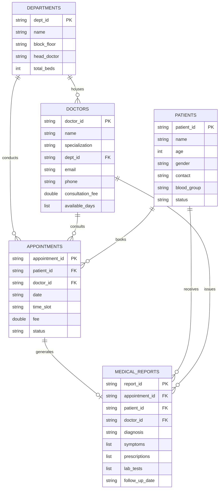

# Experiment / Practical Report 4

## Title
**Implementation of a Hospital Management System Application Using Python and MongoDB Backend**  
*(Modeling Relational-Like Documents across Departments, Doctors, Patients, Appointments, and Medical Reports with Full CRUD & $lookup Joins)*

---

### Aim
To design, implement, and demonstrate a robust Python-based application that models a Hospital Management System utilizing MongoDB as a NoSQL backend database to support full CRUD (Create, Read, Update, Delete) operations across relational-like documents (Departments, Doctors, Patients, Appointments, and Medical Reports) with cross-collection `$lookup` joins and visual healthcare analytics.

---

### Objectives
After performing this experiment, the student is able to:
1. **Model complex relational-like associations in a NoSQL document database** using document referencing.
2. **Implement full CRUD functionality across five core healthcare entities**:
   - `departments`: Clinical specialties, floor locations, and bed capacities.
   - `doctors`: Physicians, specialties, department references, fees, and schedules.
   - `patients`: Demographics, blood groups, contacts, and admission statuses.
   - `appointments`: Scheduling, patient-doctor linking, fees, and consultation states.
   - `medical_reports`: Clinical diagnoses, nested prescription arrays, and lab test results.
3. **Master cross-collection aggregation with `$lookup`** to perform SQL-like `LEFT OUTER JOIN`s.
4. **Handle nested sub-documents and document arrays** in clinical prescriptions and diagnostic tests.
5. **Compute operational hospital metrics** (departmental revenue, patient volumes, and doctor workloads) using multi-stage aggregation pipelines (`$lookup` $\rightarrow$ `$unwind` $\rightarrow$ `$group` $\rightarrow$ `$project`).
6. **Generate publication-quality healthcare visual dashboards** using Matplotlib and Seaborn.

---

## 1. Theory & Core Concepts

### 1.1 Modeling Relational-Like Data in Document NoSQL (MongoDB)
While relational databases enforce tables and strict foreign keys, document databases represent data in JSON/BSON structures. Real-world systems like Hospital Management require relationships between distinct entities. In MongoDB, this is achieved through **Document Referencing**:
- Parent collections store unique identifier keys (`dept_id`, `doctor_id`, `patient_id`).
- Child documents (`appointments`, `medical_reports`) reference these IDs.
- At query time, MongoDB’s `$lookup` stage reconstructs the relational associations on-demand without data duplication.

### 1.2 Entity-Relationship (ER) Diagram



---

## 2. Document Schema Specifications

### 2.1 Departments Collection (`departments`)
```json
{
  "dept_id": "DEP-CARD",
  "name": "Cardiology",
  "block_floor": "Block A, Floor 3",
  "head_doctor": "Dr. Rajesh Sharma",
  "total_beds": 40
}
```

### 2.2 Doctors Collection (`doctors`)
```json
{
  "doctor_id": "DOC-101",
  "name": "Dr. Rajesh Sharma",
  "specialization": "Interventional Cardiology",
  "dept_id": "DEP-CARD",
  "email": "rajesh.sharma@hospital.com",
  "phone": "+91-9876500101",
  "consultation_fee": 1200.0,
  "available_days": ["Mon", "Wed", "Fri"]
}
```

### 2.3 Patients Collection (`patients`)
```json
{
  "patient_id": "PAT-201",
  "name": "Aarav Roy",
  "age": 45,
  "gender": "Male",
  "contact": "+91-9811100201",
  "blood_group": "O+",
  "emergency_contact": "+91-9811199991",
  "status": "Outpatient"
}
```

### 2.4 Appointments Collection (`appointments`)
```json
{
  "appointment_id": "APT-301",
  "patient_id": "PAT-201",
  "doctor_id": "DOC-101",
  "date": "2026-10-25",
  "time_slot": "10:00 AM",
  "reason": "Chest tightness & breathlessness",
  "fee": 1200.0,
  "status": "Completed"
}
```

### 2.5 Medical Reports Collection (`medical_reports`)
```json
{
  "report_id": "REP-501",
  "appointment_id": "APT-301",
  "patient_id": "PAT-201",
  "doctor_id": "DOC-101",
  "diagnosis": "Hypertension & Angina Pectoris",
  "symptoms": ["Chest pain on exertion", "Elevated Blood Pressure 150/95"],
  "prescriptions": [
    {"medication": "Amlodipine", "dosage": "5mg once daily", "duration": "30 days"}
  ],
  "lab_tests": [
    {"test": "ECG", "result": "Sinus Rhythm with ST-T changes"}
  ],
  "follow_up_date": "2026-11-25"
}
```

---

## 3. Python Implementation: Relational $lookup Joins

The system executes cross-collection joins between appointments, patients, and doctors:

```python
pipeline = [
    {
        "$lookup": {
            "from": "patients",
            "localField": "patient_id",
            "foreignField": "patient_id",
            "as": "patient"
        }
    },
    {"$unwind": "$patient"},
    {
        "$lookup": {
            "from": "doctors",
            "localField": "doctor_id",
            "foreignField": "doctor_id",
            "as": "doctor"
        }
    },
    {"$unwind": "$doctor"},
    {
        "$project": {
            "_id": 0,
            "appointment_id": 1,
            "patient_name": "$patient.name",
            "patient_contact": "$patient.contact",
            "doctor_name": "$doctor.name",
            "specialization": "$doctor.specialization",
            "date": 1,
            "fee": 1,
            "status": 1
        }
    }
]
results = list(db["appointments"].aggregate(pipeline))
```

---

## 4. Verification Output & Test Results

### 4.1 Detailed Appointments View ($lookup Join Output)
```text
╒══════════════════╤═════════════════╤═══════════════════╤══════════════════════════════╤════════════╤════════════╤═══════════╕
│ Appointment ID   │ Patient Name    │ Patient Phone     │ Doctor Name & Specialization │ Date       │    Fee (₹) │ Status    │
╞══════════════════╪═════════════════╪═══════════════════╪══════════════════════════════╪════════════╪════════════╪═══════════╡
│ APT-315          │ Sunita Nair     │ +91-9811100204    │ Dr. Sneha Pillai (Neuro)     │ 2026-10-30 │   1,500.00 │ Scheduled │
│ APT-313          │ Aarav Roy       │ +91-9811100201    │ Dr. Priya Bansal (Cardio)    │ 2026-10-29 │     900.00 │ Scheduled │
│ APT-314          │ Ramesh Kulkarni │ +91-9811100203    │ Dr. Meera Nambiar (Ortho)    │ 2026-10-29 │   1,100.00 │ Scheduled │
│ APT-311          │ Karan Johar     │ +91-9811100211    │ Dr. Meera Nambiar (Ortho)    │ 2026-10-28 │   1,100.00 │ Scheduled │
│ APT-312          │ Farida Khan     │ +91-9811100212    │ Dr. Vikram Seth (Oncology)   │ 2026-10-28 │   1,800.00 │ Scheduled │
╘══════════════════╧═════════════════╧═══════════════════╧══════════════════════════════╧════════════╧════════════╧═══════════╛
```

### 4.2 Cross-Collection Department Analytics ($lookup & $group)
```text
╒══════════════╤════════════════╤═══════════════╤═══════════════╕
│ Department   │   Appointments │   Revenue (₹) │   Avg Fee (₹) │
╞══════════════╪════════════════╪═══════════════╪═══════════════╡
│ Orthopedics  │              4 │      4,200.00 │      1,050.00 │
│ Cardiology   │              4 │      4,200.00 │      1,050.00 │
│ Oncology     │              2 │      3,600.00 │      1,800.00 │
│ Neurology    │              2 │      3,000.00 │      1,500.00 │
│ Pediatrics   │              3 │      2,900.00 │        966.67 │
╘══════════════╧════════════════╧═══════════════╧═══════════════╛
```

---

## 5. Visual Analytics Generated
The system queried MongoDB collections into Pandas and generated 3 charts in `visualizations/`:
1. `1_dept_appointments_revenue.png`: Dual-axis bar chart comparing patient consultation volume and revenue across hospital departments.
2. `2_patient_demographics_blood_groups.png`: Demographic visual breakdown of patient age distributions by gender and blood group frequencies.
3. `3_hospital_executive_dashboard.png`: 4-quadrant executive dashboard showing appointment status breakdown (donut chart), fee ranges across medical specialties (box plot), patient admission status counts, and an operational audit card.

---

## 6. Learning Outcomes & Conclusion
1. Successfully designed and demonstrated a complete Hospital Management System on MongoDB.
2. Modeled complex relational-like associations across 5 distinct entities (Departments, Doctors, Patients, Appointments, and Medical Reports).
3. Successfully executed full CRUD operations across all collections.
4. Demonstrated advanced cross-collection aggregation with `$lookup` and `$unwind`.
5. Bridged NoSQL clinical records with Python Data Visualisation libraries to generate executive healthcare reports.
