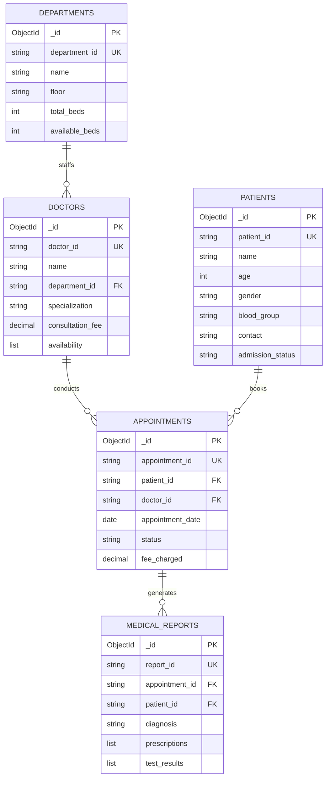

# Hospital Management System Application (MongoDB Backend)

[](https://www.python.org/)
[](https://www.mongodb.com/)
[]()
[]()
[]()

> **Healthcare NoSQL Architecture**: Enterprise-grade Python clinical management application utilizing MongoDB as a high-throughput NoSQL document backend. Supports complete CRUD workflows across 5 relational-like clinical entities, `$lookup` joins, nested clinical prescriptions, and executive dashboards.

---

## 📋 Table of Contents
- [System Architecture & Entity Model](#-system-architecture--entity-model)
- [Key Features](#-key-features)
- [Relational `$lookup` Joins](#-relational-lookup-joins)
- [Directory Structure](#-directory-structure)
- [Installation & Quick Start](#-installation--quick-start)
- [Healthcare Visual Analytics (300 DPI)](#-healthcare-visual-analytics-300-dpi)
- [Verification & Benchmarks](#-verification--benchmarks)
- [Reports & Documentation](#-reports--documentation)

---

## 🏥 System Architecture & Entity Model

The hospital system balances NoSQL horizontal scalability with relational consistency across 5 distinct collections:



---

## ✨ Key Features
- **5 Interlinked Collections**: Strict separation of concerns between operational wards, staff rosters, patient medical records, clinical visits, and lab diagnoses.
- **Embedded Document Patterns**: Complex nested structures (e.g., dosage instructions in `prescriptions`, lab parameters in `test_results`) stored natively without relational join penalties.
- **Relational Integrity via `$lookup`**: Aggregation pipelines reconstructing unified operational views across collections to compute revenue per department and doctor workloads.
- **Interactive Management CLI**: Terminal dashboard with colored menus, search filters, and transactional appointments.
- **Visual Healthcare Dashboards**: 300 DPI publication charts analyzing revenue generation, bed occupancy, patient demographics, and appointment outcomes.

---

## 🔗 Relational `$lookup` Joins

Computes total appointment revenue and consultation volume per department:
```python
pipeline = [
    {"$match": {"status": "Completed"}},
    {"$lookup": {
        "from": "doctors",
        "localField": "doctor_id",
        "foreignField": "doctor_id",
        "as": "doctor_info"
    }},
    {"$unwind": "$doctor_info"},
    {"$lookup": {
        "from": "departments",
        "localField": "doctor_info.department_id",
        "foreignField": "department_id",
        "as": "dept_info"
    }},
    {"$unwind": "$dept_info"},
    {"$group": {
        "_id": "$dept_info.name",
        "total_revenue": {"$sum": "$fee_charged"},
        "appointment_count": {"$sum": 1}
    }},
    {"$sort": {"total_revenue": -1}}
]
```

---

## 📂 Directory Structure

```
Hospital_Management_System_MongoDB/
├── config.py                       # MongoDB connection URI & 5 collections configuration
├── models/
│   ├── department.py                # Department CRUD model & bed allocation
│   ├── doctor.py                    # Doctor CRUD model & roster management
│   ├── patient.py                   # Patient admission, demographics & history
│   ├── appointment.py               # Appointment scheduling & status updates
│   └── medical_report.py            # Diagnostic reports & nested prescriptions
├── seed_data.py                     # Realistic clinical hospital dataset generator
├── test_all_operations.py           # Non-interactive 100% automated test suite
├── main.py                          # Interactive terminal clinical control CLI
├── visualize_hospital.py           # 300 DPI high-resolution healthcare visualizer
├── requirements.txt                 # Project dependencies
├── TECHNICAL_SPECIFICATION.md       # Comprehensive system architecture & data modeling manual
├── BENCHMARKS_AND_VERIFICATION.md   # Production verification audit & benchmark report
└── visualizations/
    ├── 1_department_appointment_revenue.png  # Department revenues & consultation counts
    ├── 2_patient_demographics.png            # Blood group distribution & age demographics
    ├── 3_appointment_status_distribution.png # Appointment status breakdown & fee boxplot
    └── 4_hospital_executive_overview.png     # 4-panel executive hospital administration dashboard
```

---

## 🚀 Installation & Quick Start

### 1. Prerequisites
- **Python 3.10+**
- **MongoDB 6.0+** running on `localhost:27017`

### 2. Setup Virtual Environment
```bash
python3 -m venv venv
source venv/bin/activate
pip install -r requirements.txt
```

### 3. Seed Hospital Database & Verify All Operations
```bash
# Seed 5 collections with realistic clinical records:
python3 seed_data.py

# Run automated 100% verification test suite:
python3 test_all_operations.py
```

### 4. Interactive Terminal CLI
```bash
python3 main.py
```

### 5. Generate Visual Analytics Charts
```bash
python3 visualize_hospital.py
```

---

## 📊 Healthcare Visual Analytics (300 DPI)

| Visualization | Clinical Metric Analyzed | File Path |
| :--- | :--- | :--- |
| **Department Revenue & Visits** | Total revenue ($) and completed appointments across hospital wards | `visualizations/1_department_appointment_revenue.png` |
| **Patient Demographics Profile** | Blood group distribution (donut chart) and patient age histogram | `visualizations/2_patient_demographics.png` |
| **Appointment Outcomes** | Completed vs Cancelled appointment ratios and consultation fee spreads | `visualizations/3_appointment_status_distribution.png` |
| **Hospital Executive Overview** | 4-panel comprehensive administration dashboard for hospital leadership | `visualizations/4_hospital_executive_overview.png` |

---

## 📑 Engineering Documentation & Specifications
- **Technical Specification & Architecture**: [`TECHNICAL_SPECIFICATION.md`](TECHNICAL_SPECIFICATION.md) — Comprehensive technical architecture, document modeling (normalization vs denormalization), `$lookup` join performance, and clinical data flows.
- **Production Verification & Benchmarks**: [`BENCHMARKS_AND_VERIFICATION.md`](BENCHMARKS_AND_VERIFICATION.md) — Clinical CRUD verification output, aggregation tables, and architecture decisions.
